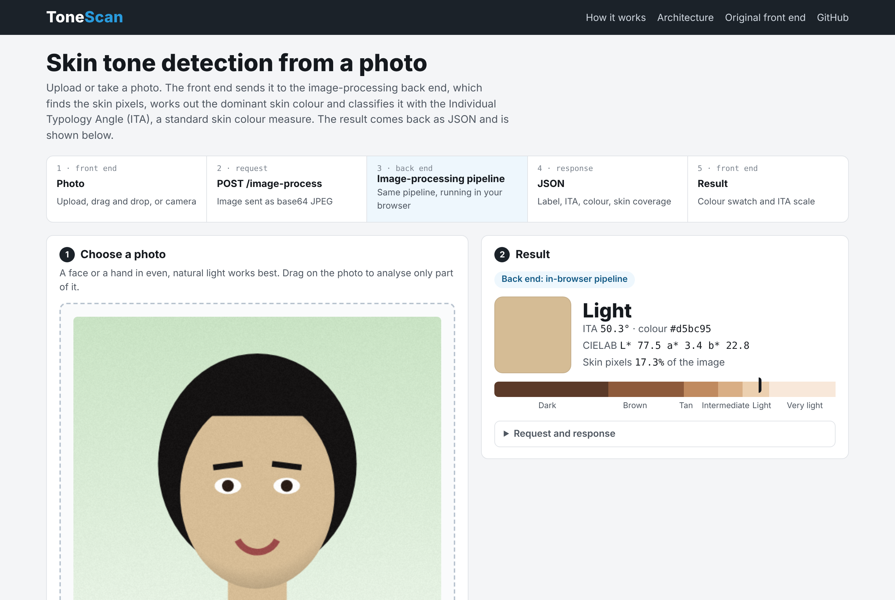
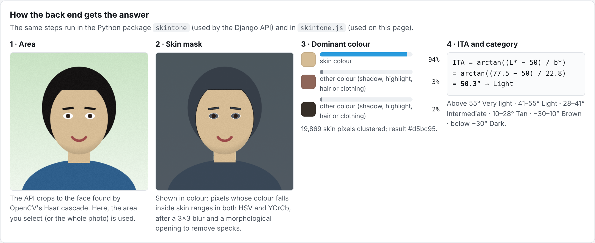
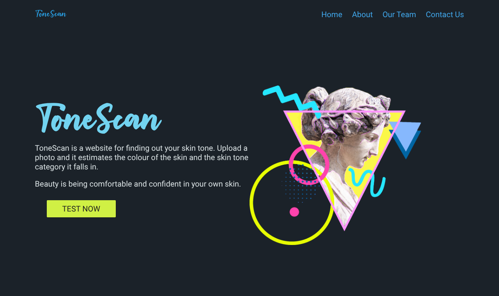

# ToneScan: Skin Tone Detection (OpenCV, Django, JavaScript)

[](https://github.com/codeind/Skin-Tone-Detection-OpenCV/actions/workflows/ci.yml)

**A web app that takes a photo, sends it to an image-processing back end, and returns the skin colour and its skin tone category. The front end is HTML, CSS and JavaScript; the back end is a Django REST API running an OpenCV and NumPy pipeline that measures skin tone with the Individual Typology Angle (ITA).**

🌐 **[Try it live](https://codeind.github.io/Skin-Tone-Detection-OpenCV/web/)** · 🖥️ [Original front end](https://codeind.github.io/Skin-Tone-Detection-OpenCV/original_site/HTML/tonescan.html) · 📓 [Walkthrough notebook](notebooks/skin_tone_analysis.ipynb) · 🔌 [API](api/)

[](https://codeind.github.io/Skin-Tone-Detection-OpenCV/web/)

---

## How it works

```
Front end (browser)                    Back end                                   Front end
upload / drag and drop / camera  ──►  POST /image-process  ──►  skintone pipeline  ──►  JSON  ──►  swatch, label, ITA scale
                                      (Django REST Framework)   (OpenCV + NumPy)
```

| Step | What happens |
|---|---|
| 1. Area | The API finds the largest face with OpenCV's Haar cascade and keeps its inner 70%, which drops hair and background. On the web demo you can drag to select an area instead. |
| 2. Skin mask | A 3×3 blur, then pixels are kept only if their colour is inside skin ranges in **both** HSV and YCrCb. A 3×3 morphological opening removes isolated specks. |
| 3. Dominant colour | The skin pixels are grouped into 3 clusters with **k-means in CIELAB** colour space. The largest cluster (plus any cluster within ΔE 10 of it) is the skin colour; shadows, highlights and skin-coloured clothing fall into the others. |
| 4. ITA | The Individual Typology Angle, `ITA = arctan((L* − 50) / b*)`, is a standard measure of skin colour used in dermatology. |
| 5. Category | Above 55° Very light, 41–55° Light, 28–41° Intermediate, 10–28° Tan, −30–10° Brown, below −30° Dark. |



**Example response**

```json
{"label": "Light", "ita": 50.1, "lab": [77.4, 3.0, 22.9], "rgb": [213, 188, 149], "hex": "#d5bc95",
 "skin_fraction": 0.1734, "cluster_share": 0.97, "face_found": true}
```

### Live demo and the back end

GitHub Pages can only serve static files, so the live page can't call a Python server. Instead, the same pipeline is ported to JavaScript ([`web/skintone.js`](web/skintone.js)) and runs in a Web Worker that stands in for the API. It takes the same request and returns the same JSON fields, so the photo never leaves the browser. A parity test ([`tests/test_parity.mjs`](tests/test_parity.mjs)) checks that the JavaScript and Python versions give the same label, skin pixel count and ITA (within 0.1°) on 11 test images.

To use the real Django API, run it locally and open the page with `?api=http://127.0.0.1:8000/image-process`. The original front end's upload page calls the API automatically when it is opened locally.

## Results on reference colours

The tests use the 10 colours of the [Monk Skin Tone Scale](https://skintone.google) drawn into synthetic scenes with lighting, noise and different backgrounds (no photos of people).

| Monk tone | 1 | 2 | 3 | 4 | 5 | 6 | 7 | 8 | 9 | 10 |
|---|---|---|---|---|---|---|---|---|---|---|
| ITA of the colour | 83.0 | 80.2 | 71.8 | 64.7 | 50.3 | 10.9 | −20.1 | −55.4 | −78.4 | −84.3 |
| Measured, with side lighting | 83.0 | 80.4 | 71.9 | 64.7 | 51.9 | 14.2 | −15.9 | −52.9 | −79.6 | −84.1 |
| Category | Very light | Very light | Very light | Very light | Light | Tan | Brown | Dark | Dark | Dark |

## What changed from the original version

The first version of the ML code is kept unchanged in [`original_ml/`](original_ml/). Testing it on the same reference colours showed:

| Original | Now |
|---|---|
| The Django version read images as RGB but converted them as if they were BGR, so the skin mask kept **0%** of every reference skin colour | One colour conversion path, tested against OpenCV |
| R, G and B were packed into one number and compared against ranges (with 255 and 265 where 256 was meant): even with the exact colour, the 6 lightest tones were all "fair", "mild" never came up, and the 2 darkest were "Unrecognized" | ITA from CIELAB with 6 standard categories, which orders all 10 reference tones correctly |
| Crashed when no skin was found | Returns `"No skin detected"` |
| Every upload was written to the same file on disk, so two users at once would overwrite each other | Images are decoded in memory |
| `skindetect.py` had a syntax error | Replaced by `python -m skintone photo.jpg` |
| Secret key committed in settings | Read from an environment variable |
| No tests | 30 pipeline tests, 6 API tests and the Python vs JavaScript parity test, run by GitHub Actions on every push |

## Front end

[`original_site/`](original_site/) is the original ToneScan website: home page, upload page with drag and drop, contact form and sign-in/sign-up screens. The sign-in and sign-up pages are design mockups (accounts are not implemented) and are labelled as such.



## How to run

```bash
pip install -r requirements.txt

python -m skintone photo.jpg                 # command line, prints the JSON result
python api/manage.py runserver               # API at http://127.0.0.1:8000/image-process
python -m http.server 8080                   # then open http://localhost:8080/web/

pytest -q                                    # pipeline tests
python api/manage.py test upload             # API tests
node tests/test_parity.mjs                   # Python vs JavaScript
```

## Limitations

- The result describes the photo, not the person: lighting, white balance, camera processing, filters and make-up all change the measured colour.
- Skin-coloured backgrounds and clothing (beige walls, wood, some reds) pass the colour thresholds. Face cropping, area selection and taking the largest colour cluster reduce this but don't remove it.
- The thresholds are general-purpose skin ranges, checked on synthetic reference colours; they have not been tuned or evaluated on a labelled photo dataset.
- It is not a medical, dermatological or cosmetic diagnosis tool.

## Skills

Python (OpenCV, NumPy, scikit-learn) · image processing (colour spaces, thresholding, morphology, Haar cascade face detection) · k-means clustering · colour science (CIELAB, ITA) · Django and Django REST Framework · JavaScript (Canvas, Web Workers, camera API, drag and drop) · HTML and CSS · pytest · GitHub Actions

## Repository structure

```
├── web/                    live demo (GitHub Pages): index.html, skintone.js, backend.worker.js
├── original_site/          original front end (HTML, CSS, JavaScript)
├── api/                    Django REST API: POST /image-process
├── skintone/               Python pipeline (core.py) and command line (__main__.py)
├── notebooks/skin_tone_analysis.ipynb    step-by-step walkthrough and comparison with the original
├── original_ml/            first version of the ML code, unchanged
├── tests/                  pytest, parity fixture and test_parity.mjs
├── images/                 screenshots
└── .github/workflows/ci.yml
```
